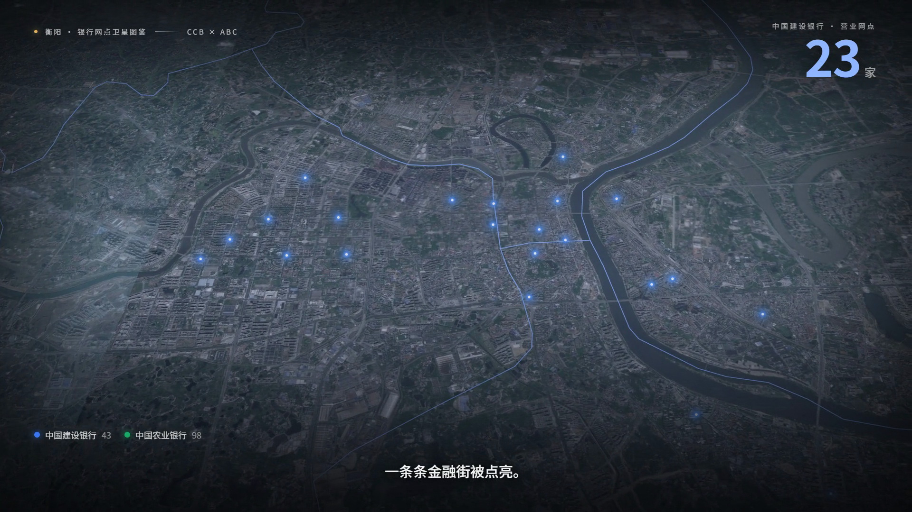

# 衡阳 · 建行 vs 农行 网点卫星图鉴

一支用真实网点坐标 + 卫星影像做的数据讲解短片：**同一个衡阳，两家大行，两套完全不同的落子方式。**

- 视频：`output/hengyang_banks.mp4`（1080p / 30fps / 约 2 分 05 秒）
- 封面：`docs/cover.png`
- 交互版：起本地服务后打开 `http://127.0.0.1:8765/src/index.html`，可拖动时间轴逐帧查看



---

## 一句话结论

> **建行守城，农行下乡。**
> 建行 43 个网点里超过一半压在市区四区；农行 98 个网点里七成撒在县域，最远的一个离市中心 91 公里。

| 指标 | 中国建设银行 | 中国农业银行 | 对比 |
|---|---:|---:|---|
| 营业网点总数 | **43** | **98** | 农行是建行的 **2.28 倍** |
| 市区四区网点 | 23（53.5%） | 28（28.6%） | 建行更"城里" |
| 县域网点 | 20（46.5%） | 70（71.4%） | 农行更"下沉" |
| 网点间距中位数 | **998 m** | **2398 m** | 建行在主城加密，农行在县域铺网 |
| 平均离市中心 | 22.2 km | 33.6 km | — |
| 最远离市中心 | 62.3 km（耒阳电厂支行） | 91.3 km（祁东太和堂支行） | — |

**两行贴脸开大的程度**：全市有 **34 对**网点相距不到 500 米，14 对不到 300 米，8 对不到 200 米。
最近的一对在衡东县城关镇兴衡西路：**建行衡东支行（15 号）** 与 **农行衡东支行营业室（17 号）**，门牌挨着门牌，**相距 49 米**。

### 分区县明细

| 区县 | 建行 | 农行 | | 区县 | 建行 | 农行 |
|---|---:|---:|---|---|---:|---:|
| 蒸湘区 | 9 | 11 | | 衡阳县 | 3 | 14 |
| 石鼓区 | 5 | 7 | | 衡南县 | 2 | 12 |
| 珠晖区 | 5 | 6 | | 祁东县 | 3 | 11 |
| 雁峰区 | 4 | 4 | | 衡东县 | 2 | 8 |
| 耒阳市 | 5 | 10 | | 衡山县 | 1 | 6 |
| 常宁市 | 3 | 8 | | 南岳区 | 1 | 1 |

---

## 数据从哪来

两份数据都来自**银行官网自己的网点查询系统**，不是第三方地图的二手 POI：

| 银行 | 来源 | 接口 | 口径 |
|---|---|---|---|
| 中国建设银行 | 官网「[网点及ATM查询](https://www.ccb.com/cn/home/map/branchSearch.html)」 | `www3.ccb.com/tran/WCCMainPlatV5` `TXCODE=NZX013`，`ADiv_Cd=430400`，`Enqr_MtdCd=1` | 营业网点（不含自助银行 / ATM） |
| 中国农业银行 | 官网「[营业机构查询](https://app.abchina.com.cn/branch/)」 | `app.abchina.com.cn/mobileSite/Branch/mobileSearchBranch`，`cityId=430400` | 营业网点（`TypeId=1`） |

- 采集时间：**2026-11-10**
- 坐标系：**GCJ-02**。建行页面显式声明 `BMAP_COORD_GCJ02`；农行与建行同址网点最近邻距离中位数 < 300 m，判定同属 GCJ-02。
- 清洗结果：[`data/processed/branches.csv`](data/processed/branches.csv) / [`branches.geojson`](data/processed/branches.geojson) / [`stats.json`](data/processed/stats.json)

> ⚠️ 口径说明：只统计"营业网点"，不含自助银行、ATM、社区支行；以官网当日数据为准，可能随网点调整变化。

---

## 怎么做的

```
建行/农行官网接口 ──► 清洗统一口径 ──► 统计分析
                                      │
高德卫星瓦片 ──► 本地瓦片缓存 ──► MapLibre GL ──► 逐帧渲染 ──► ffmpeg ──► MP4
                                      │
                              edge-tts 中文旁白 ──► 混音（配乐底床）──┘
```

- **底图**：高德卫星影像（`webst0x.is.autonavi.com`，GCJ-02，与网点坐标同系），本地缓存到 `output/tilecache/`
- **渲染**：MapLibre GL 负责相机与卫星图层，Canvas 2D 叠加光点/边界/标注；页面暴露 `window.renderAt(t)`，所有动画只由时间 `t` 决定，因此可以逐帧确定性截图
- **录制**：Playwright（Chromium + SwiftShader）逐帧截图，直接管道送进 ffmpeg，不落中间图
- **旁白**：edge-tts `zh-CN-YunjianNeural`，按音频实际时长反推时间轴
- **配乐**：numpy 合成的低频铺底 + 场景切换 whoosh，混在旁白下方约 -20 dB

> 踩过的坑：叠加图层是全透明时，Chrome 会把这层画布从合成里剔除，截图就会一直停留在上一帧（表现为标题页叠着上一场景的光点）。解决办法是每帧在画布角落画一个 alpha=0.004 的像素，让它永远"非空"。见 `src/app.js` 里的注释。

### 叙事结构

| 时间 | 场景 | 画面 |
|---|---|---|
| 0:00 | 标题 | 中国上空卫星缓慢推近，标题浮现 |
| 0:08 | 推近 | 中国 → 湖南 → 衡阳，市域轮廓点亮 |
| 0:22 | 建行 | 蓝色光点从主城逐颗亮起，计数 0→43，先城市后县域 |
| 0:41 | 农行 | 绿色光点从主城向四周铺开，计数 0→98 |
| 1:01 | 对比 | 右侧 12 个区县双色柱状图生长，同屏 53.5% vs 28.6% |
| 1:12 | 贴脸 | 镜头俯冲到衡东县城，两个网点 49 米门对门 |
| 1:28 | 节奏 | 20–100 km 距离环 + 最近邻间距 998 m vs 2398 m |
| 1:46 | 结尾 | 双色图层同框：建行守城，农行下乡 |

---

## 复现

```bash
# 0) 依赖
pip install requests edge-tts playwright numpy scipy
python -m playwright install chromium

# 1) 抓数据（需国内网络）
python scripts/fetch_ccb.py
#    农行接口有旧式 TLS 重协商，用浏览器抓更稳，原始响应已存 data/raw/

# 2) 清洗 + 统计
python scripts/analyze.py

# 3) 生成旁白与时间轴
python scripts/tts.py

# 4) 启动本地服务（静态文件 + 卫星瓦片缓存）
python scripts/serve.py 8765

# 5) 出片
python scripts/build_audio.py
python scripts/render.py --out output/video_raw.mp4
ffmpeg -i output/video_raw.mp4 -i output/audio/mix.wav \
       -c:v libx264 -crf 22 -preset slow -pix_fmt yuv420p -c:a aac -b:a 192k \
       -shortest -movflags +faststart output/hengyang_banks.mp4
```

## 关于 svganimate.ai

原始需求是"试试 [svganimate.ai](https://svganimate.ai/zh/home) 能不能做"。实测结论：它有「卫星地图讲解」风格、能生成旁白字幕，但**必须微信/Google 登录**，**没有 API/CLI**，**不能导入坐标数据**，且官方 FAQ 明确说不适合写实图像。

完整测试记录（含登录弹窗截图）见 [`docs/svganimate-test.md`](docs/svganimate-test.md)。

## 目录

```
data/raw/            官网原始响应
data/processed/      清洗后的网点表、GeoJSON、统计
src/                 HTML / CSS / JS 渲染页 + 时间轴
scripts/             抓取、清洗、TTS、瓦片服务、渲染、混音
output/              成片、预览帧、音频、瓦片缓存
docs/                测试记录、封面
```

## 版权与免责声明

- 网点数据版权归中国建设银行、中国农业银行所有，此处仅作数据分析与可视化研究使用。
- 卫星影像 © 高德地图，仅供学习演示，不用于商业分发。
- 统计结果基于 2026-11-10 官网公开数据，不构成任何投资或选址建议。
